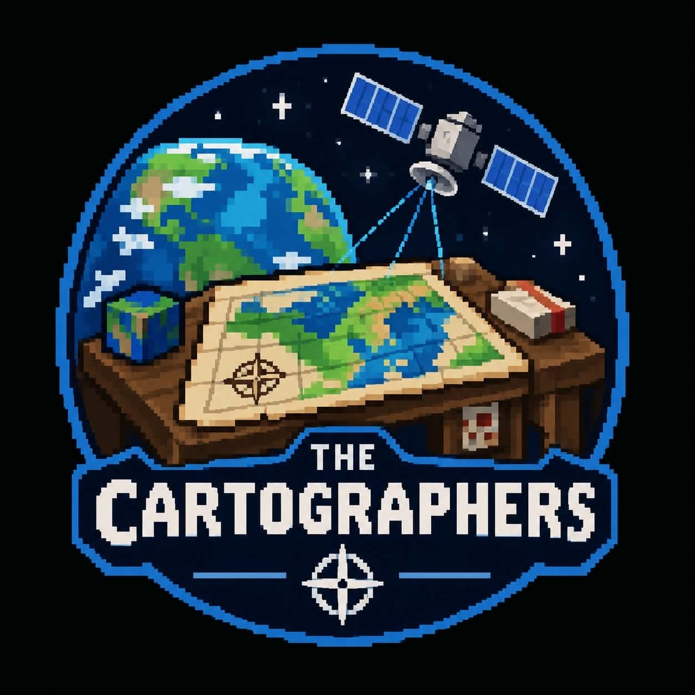
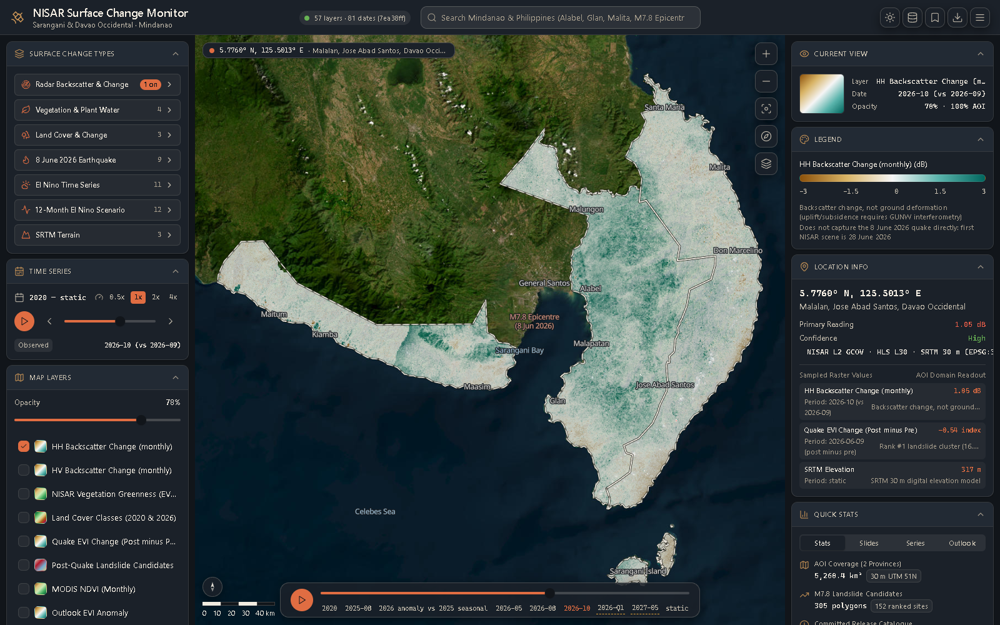
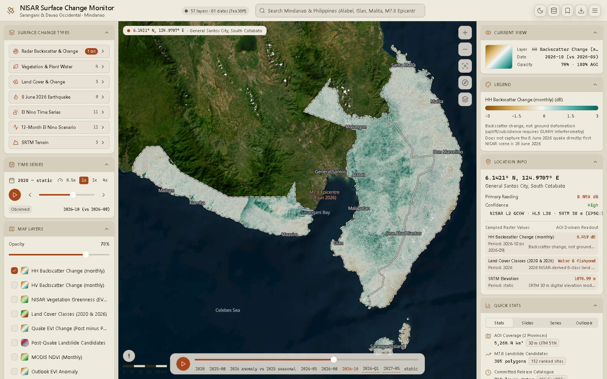
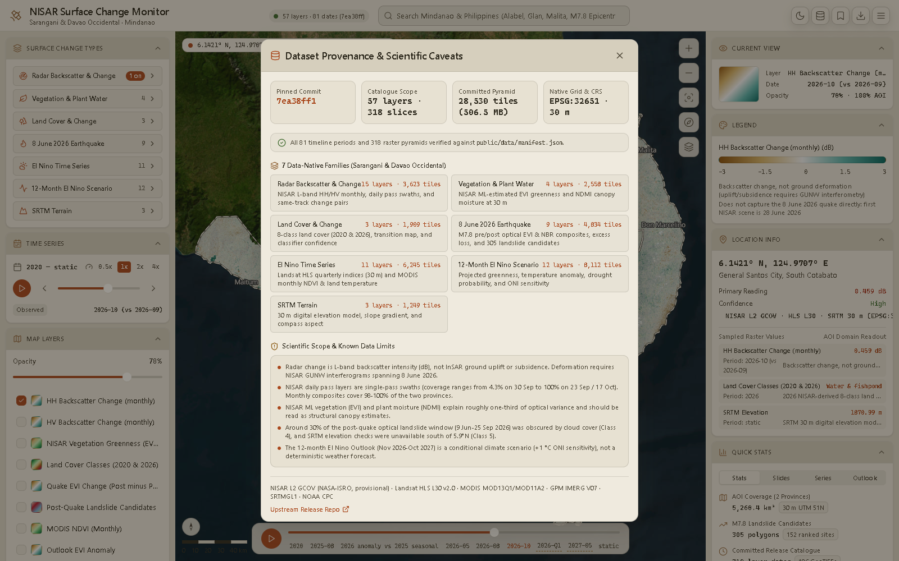

# NISAR Surface Change Monitor

**Team:** The Cartographers — [NASA Space Apps Challenge 2026](https://www.spaceappschallenge.org/2026/find-a-team/the-cartographers/)

## About the Challenge

<div style="display: flex; align-items: center; gap: 24px;">
  
  <div style="flex: 1;">
    <h3>Dancing with the SARs</h3>
    <p>Earth's surface is an endless dance of natural processes and human activities, but these changes are often difficult to visualize, understand, and communicate. From wetland loss to forest wildfires, earthquakes, farming activities, glacier movement, and more, Earth is in a constant waltz of surface changes. Your challenge is to build an interactive application that uses radar remote sensing data from the NASA-ISRO Synthetic Aperture Radar (NISAR) mission to track and visualize one or more types of surface change at locations around the world.</p>
  </div>
</div>

## Sample Screenshots

Representative desktop views of the running app, captured at 1600 × 1000. Click any image to view it at full size. To regenerate them, or the data and tiles behind them, see [docs/SETUP.md](docs/SETUP.md).

| Sand Atlas · Light Dashboard | Night Atlas · Dark Dashboard |
| --- | --- |
| [](docs/screenshots/dashboard-light.png) | [](docs/screenshots/dashboard-dark.png) |
| Explore surface-change layers, adjust opacity, and navigate the timeline. | View the same map workspace in the dark theme. |

| Location Inspection | Dataset Provenance |
| --- | --- |
| [](docs/screenshots/location-inspection.png) | [](docs/screenshots/data-provenance.png) |
| Click the map to inspect coordinates and layer readings. | Review the pinned data release, catalogue coverage, and interpretation limits. |

To refresh these images, start `pnpm dev --host 127.0.0.1 --port 5173`, then run `python scripts/capture_screenshots.py` in another terminal. The capture script requires Python Playwright and Microsoft Edge; it does not add frontend dependencies.

## Getting Started

```bash
pnpm install
pnpm run tauri dev
```

## Build

```bash
pnpm run tauri build
```

## Documentation

Full documentation (user guide, data catalogue, tile pipeline, architecture) is an Astro Starlight site in `apps/docs`:

```bash
pnpm docs:dev     # http://localhost:4321
pnpm docs:build   # static site in apps/docs/dist/
```

## Project Structure

The repository is a pnpm workspace:

- `apps/web`: the React + Vite frontend (`src/`, `public/`, `tests/`).
- `apps/desktop`: the Tauri v2 shell (`src-tauri/`), which wraps the `apps/web` build.
- `apps/docs`: the Astro Starlight documentation site.
- `scripts/`: the Python tile pipeline (writes into `apps/web/public/`) and screenshot capture.

Root scripts (`pnpm dev`, `pnpm build`, `pnpm test`, `pnpm lint`, `pnpm tauri dev`) forward to the right package.

See `docs/superpowers/specs/2026-10-10-project-structure-design.md` for the full architecture spec.

The "Dancing with the SARs" challenge is one of the official global tracks featured in the 2026 NASA Space Apps Challenge. [1] (https://www.spaceappschallenge.org/2026/challenges/dancing-with-the-sars/), [2] (https://www.therecursive.com/nasa-space-apps-challenge-2026-where-to-join-it-in-cee/)

What the Challenge Is About

• Goal: Build an interactive application or tool that tracks and visualizes Earth surface changes using radar remote sensing data. [1] (https://www.spaceappschallenge.org/2026/challenges/dancing-with-the-sars/)
• Core Dataset: Uses data from the NASA-ISRO Synthetic Aperture Radar (NISAR) mission. [1] (https://www.spaceappschallenge.org/2026/challenges/dancing-with-the-sars/)
• Focus Areas: Translating complex radar data to monitor natural processes and human activities—such as earthquakes, glacier movement, wetland loss, forest wildfires, riverbank erosion, and farming activities. [1] (https://www.youtube.com/watch?v=NlmBUn8bIwk), [2] (https://www.spaceappschallenge.org/2026/challenges/dancing-with-the-sars/)
