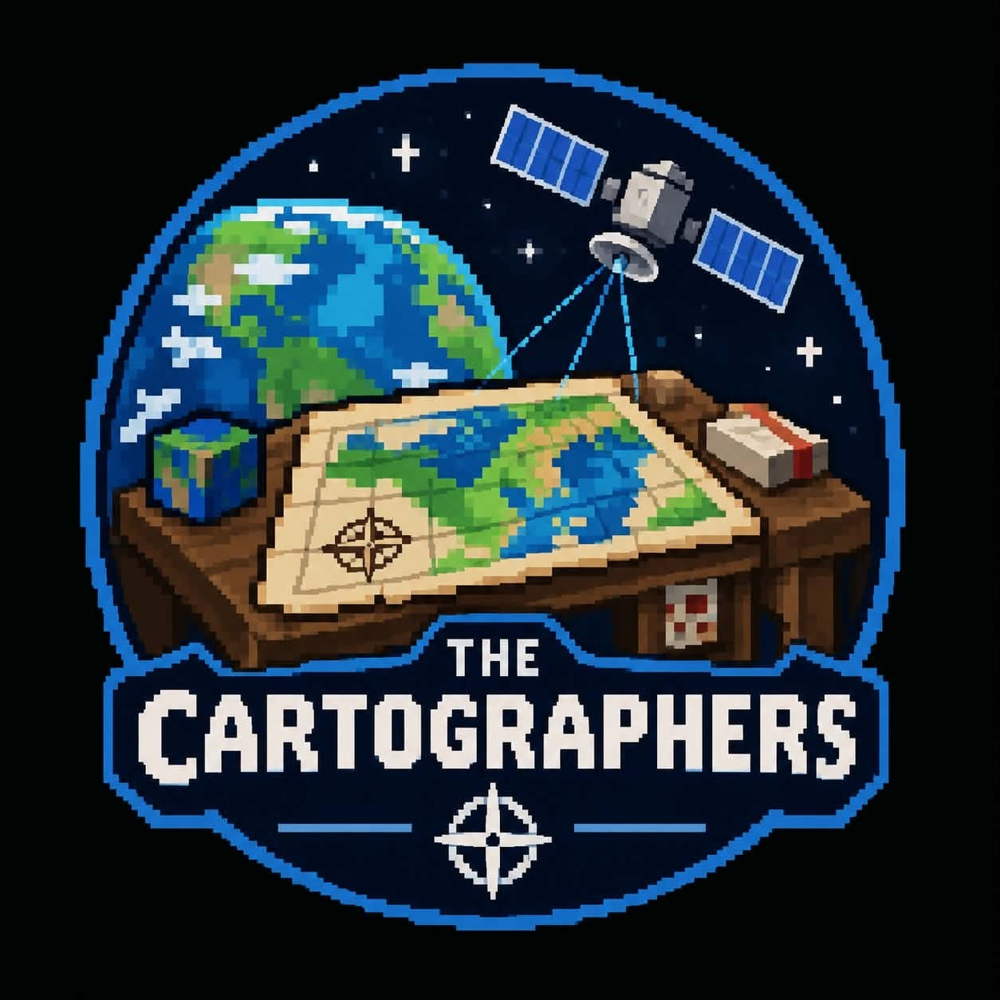

**The Cartographers** are a team from the Philippines that built the NISAR Surface Change
Monitor for the [NASA Space Apps Challenge 2026](https://www.spaceappschallenge.org/2026/find-a-team/the-cartographers/)
at the **Manila, Philippines** local event, in the
[Dancing with the SARs](https://www.spaceappschallenge.org/2026/challenges/dancing-with-the-sars/)
challenge.

## Members

| Member | Role | Country |
| --- | --- | --- |
| **Peter Dominic Montero** | Team owner | Philippines |
| **Athena Kristine G. Combalicer** | Member | Philippines |
| **Alistair M. Ybanez** | Member | Philippines |
| **Habi Chenna G. Garduque** | Member | Philippines |
| **Daniel Cresino** | Member | Philippines |
| **Alfie Pelicano** | Member | Philippines |

The member list comes from the team's
[Space Apps team page](https://www.spaceappschallenge.org/2026/find-a-team/the-cartographers/?tab=members).

## Skills and interests

Animation · artificial intelligence and machine learning · coding · data visualization ·
statistics · storytelling · waste and resources · web development.

Languages spoken: English and Tagalog.

## Links

- [Project repository](https://github.com/Drakaniia/Dancing_with_the_SARs)
- [Upstream data release](https://github.com/monteropeterdominic-arch/sarangani-davao-occidental-nisar)
- [Space Apps team page](https://www.spaceappschallenge.org/2026/find-a-team/the-cartographers/)

## Acknowledgements

Data comes from:

- NASA-ISRO NISAR (L2 GCOV, provisional).
- Landsat HLS.
- NASA MODIS (MOD13Q1/MOD11A2).
- NASA GPM IMERG.
- SRTM.
- NOAA CPC.

Basemap imagery is from Esri World Imagery. NASA Space Apps is funded by NASA's Science Mission
Directorate.
