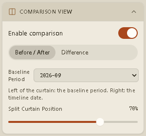
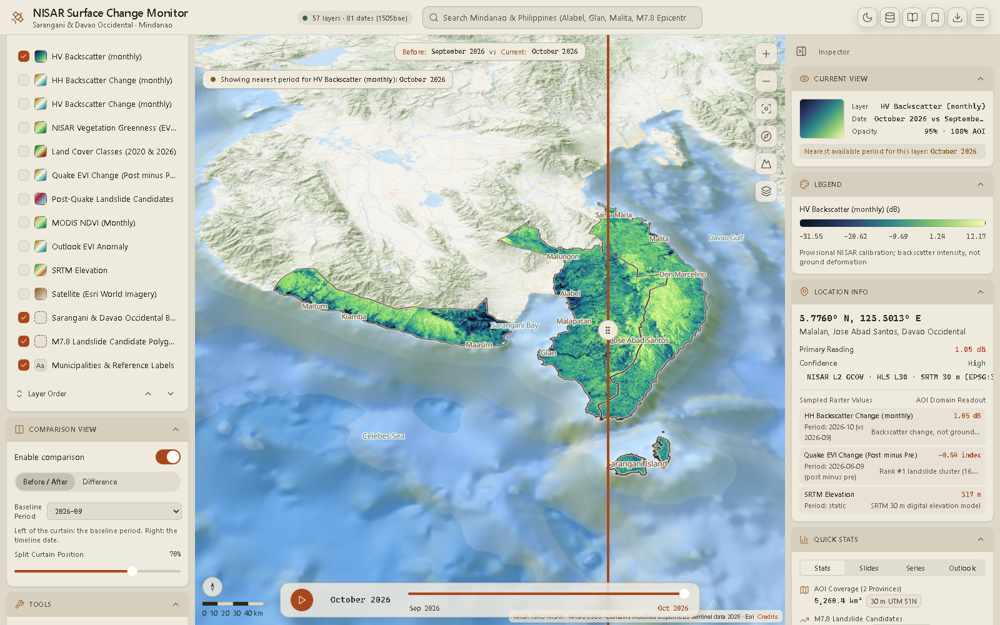

The **Comparison View** panel in the left rail compares a **baseline period** with the
**current** timeline period on the map itself.

## Turning it on

1. Open **Comparison View** in the left rail.
2. Switch **Enable comparison** on.
3. Pick a mode:
   - **Before / After:** a swipe. Left of the curtain shows the baseline period, right of it
     shows the timeline date.
   - **Difference:** left of the curtain shows the colour difference between the two periods.
     Pixels that did not change turn black; change stands out in colour.
4. Choose a **Baseline Period** from the drop-down. It lists every period in `manifest.dates`.
   The default is `2026-09`.

A badge at the top centre of the map summarises the comparison, for example
`Before: 2026-09 vs Current: 2026-10 (vs 2026-09)`. The current side shows the active layer's
**resolved** period, so snapping is visible here too.

## The swipe curtain

- Drag the handle across the map, or use the **Split Curtain Position** slider (5–95 %).
- With the handle focused, the **←** and **→** keys move it in 5 % steps.
- Pan, zoom, tilt and rotate the map as usual: both sides move together.

## What each side draws

The baseline side is a second map stacked on the main one and clipped to the left of the
curtain. It follows the main map's camera, uses the same 3D terrain, and mirrors the
**Map Layers** switches (satellite basemap, boundary, landslide polygons, labels).

Every visible data layer is drawn at the baseline period. Like the timeline, a layer with no
data for that period snaps to its nearest one, so a one-date layer looks the same on both sides.

Picture maps from the **Explore** panel are drawn on both sides too. The outlook months show the
month nearest the baseline period. The slope map, the Sentinel-1 radar check and the NISAR watch
list have one picture each, so they look the same on both sides.

:::note
For a computed change product rather than a visual comparison, use the pair layers:

- `radar-change-hh-monthly` / `radar-change-hv-monthly`: Oct vs Sep 2026.
- The same-track change layers, for example `2026-10-14 (vs 2026-09-20)`.
- `earthquake-evi-change-2026` / `earthquake-nbr-change-2026`: post minus pre.
- `landcover-change-2020-2026`.
  :::
