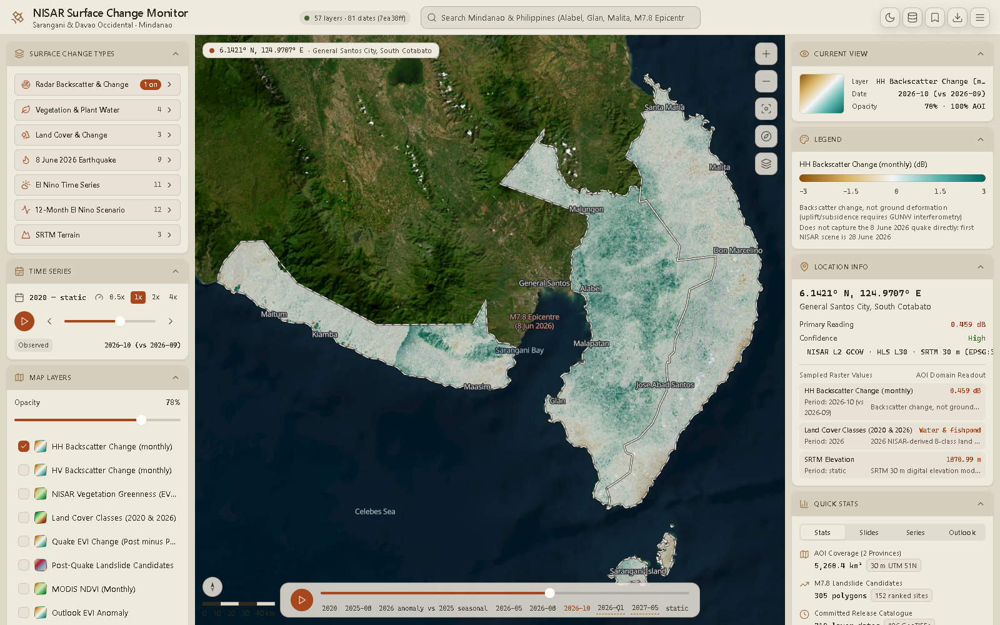

## Click to inspect

Click anywhere on the map. The **Location Info** panel in the right rail then shows:

- **Coordinates** to four decimals, for example `6.0215° N, 125.1470° E`.
- The **nearest place name** from the built-in gazetteer (`apps/web/src/features/search/locations.ts`).
- A **primary reading** for the active layer.
- **Sampled Raster Values:** one row per sampled layer, with the value and units (or the class
  name for categorical layers), the period actually sampled, and the layer's first caveat.

The layers sampled are the visible data layers and the active layer, plus
**SRTM Elevation** and **Land Cover Classes** for context.

### Desktop: real values from the GeoTIFFs

In the Tauri app, a click calls the Rust command
[`sample_layers`](/architecture/backend/#sample_layers). The command:

1. Projects the WGS84 click to UTM 51N (EPSG:32651).
2. Picks each layer's entry for the current period, or the nearest earlier one.
3. Reads the pixel straight from the source GeoTIFF in `data/`.
4. Applies the `scaleFactor`, turns `nodata` into "nodata", and maps class codes to labels.

The panel labels these readings **GeoTIFF Direct**.

### Browser or missing data: placeholder readings

:::caution
If the app is not running in Tauri, or the GeoTIFFs are not present in `data/`, the panel
falls back to **AOI Domain Readout**. These values are **deterministic placeholders** derived
from each layer's domain and classes, **not measurements**. Outside the area of interest, every
layer reads as nodata. Use the desktop app with `data/` populated whenever the numbers matter.
:::

## Current View

The **Current View** card summarises the active layer: name, current date, opacity, and
coverage of the area of interest where known. When the layer snaps to another period, it says
**Nearest available period for this layer**.

## Quick Stats

The **Quick Stats** panel has four tabs, all driven by `apps/web/public/data/tables.json`:

| Tab | Contents |
| --- | --- |
| **Stats** | Area of interest (5,268.4 km²), 305 landslide candidate polygons, 318 layer-dates in the catalogue |
| **Slides** | The top 25 of **152 ranked landslide clusters** after the 8 June M7.8 quake (barangay, municipality, area) |
| **Series** | Monthly NDVI and daytime land temperature for the area of interest (2025–2026): a two-line SVG chart and a table |
| **Outlook** | The 12-month El Niño scenario: rainfall, EVI anomaly and land temperature anomaly per month |

Rows in these tabs are interactive:

- **A landslide row** turns on the landslide candidate raster and polygons, flies to the cluster
  at zoom 13, and inspects it.
- **A month row** in Series sets the timeline to that month.
- **A month row** in Outlook turns on **Outlook EVI Anomaly** and sets the timeline to that
  month.
