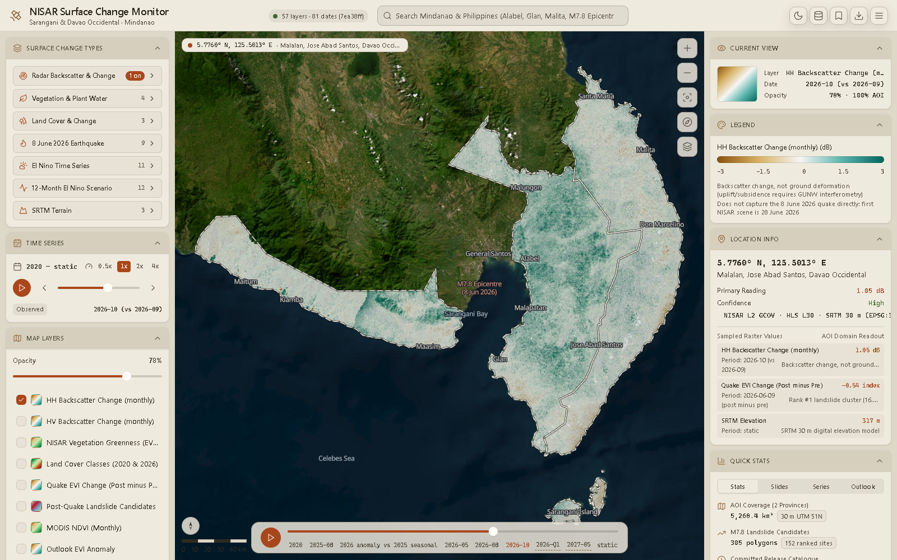

The dashboard is map-first. A top bar runs across the window. Below it, a left rail holds the
controls, the map fills the centre, and a right rail shows what you are looking at.

## Top bar

- **Title and data status.** The status pill reads the manifest (for example `57 layers`).
  It has a tile-warning state (`57 layers · N tile warning(s)`), but tile failures are not
  reported to it yet. Click the pill to open the [provenance dialog](/Dancing_with_the_SARs/data/limitations/).
- **Global search.** Jump to the epicentre, landslide clusters, municipalities and other places.
  See [Search, bookmarks and tools](/Dancing_with_the_SARs/guide/tools/).
- **Actions.** Theme toggle, data provenance, bookmarks, export and settings.

## Left rail: controls

| Panel | Purpose |
| --- | --- |
| **Surface Change Types** | Every data layer, grouped into seven collapsible families. See [Datasets and layers](/Dancing_with_the_SARs/guide/layers/). |
| **Time Series** | The global timeline, current period, and playback. See [Timeline and playback](/Dancing_with_the_SARs/guide/timeline/). |
| **Map Layers** | Visible and pinned layers, opacity, and draw order. |
| **Comparison View** | Before/after split curtain or difference mode. See [Comparison view](/Dancing_with_the_SARs/guide/comparison/). |
| **Tools** | Measure, Inspect, Bookmark and Export. |

## Centre: the map

The MapLibre GL map opens fitted to the area of interest. Satellite imagery (Esri World Imagery)
sits at the bottom, data overlays in the middle, and the province boundary, landslide polygons and
reference labels on top. Zoom and north controls, a scale bar and the playback bar sit over the
map.

## Right rail: context

| Panel | Purpose |
| --- | --- |
| **Current View** | The active layer, its period, and whether the period was snapped. |
| **Legend** | The ramp or class legend for the active layer, generated from the manifest. |
| **Location Info** | Coordinates, place name and sampled pixel values at the last click. |
| **Quick Stats** | Stats, ranked landslides, monthly series and the outlook table. |

Panels collapse and expand from their headers. In the desktop app, their open/closed state is
saved with the Tauri store plugin.

## Themes

Two themes share the same layout:

- **Sand Atlas:** warm light, the default.
- **Night Atlas:** dark.

Switch with the moon/sun button in the top bar, or in **Settings → Appearance**. The choice is
saved in `localStorage`.

## Responsive rail modes

The shell adapts to the window width (`useRailMode`):

| Mode | Width | Layout |
| --- | --- | --- |
| `wide` | ≥ 1440 px | Left rail, map, right rail |
| `default` | 1024–1439 px | Left rail and map; the right rail opens as a sheet |
| `compact` | < 1024 px | Map only; both rails open as sheets |
