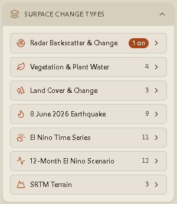
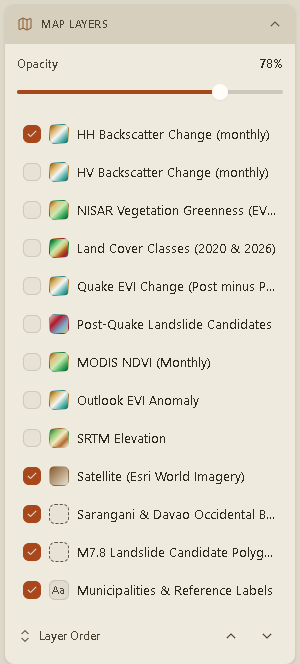
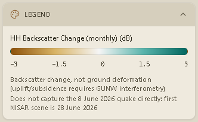

Every data layer in the app comes from the [manifest](/Dancing_with_the_SARs/data/manifest/). There are **57 layers**
in **seven families**. The full list is in the [layer catalogue](/Dancing_with_the_SARs/data/catalogue/).

## Surface Change Types (left rail)

Layers are grouped into collapsible family sections:

| Family | UI label | What it shows |
| --- | --- | --- |
| `radar` | Radar Backscatter & Change | NISAR L-band HH/HV backscatter and change, in dB |
| `vegetation` | Vegetation & Plant Water | Radar-estimated EVI greenness and NDMI moisture |
| `landcover` | Land Cover & Change | 2020/2026 classes, confidence, change |
| `earthquake` | 8 June 2026 Earthquake | Pre/post EVI and NBR, landslide candidates |
| `climate` | El Nino Time Series | Landsat HLS quarterly and MODIS monthly indices and temperature |
| `outlook` | 12-Month El Nino Scenario | Expected values, anomalies, chances and sensitivities, Nov 2026–Oct 2027 |
| `terrain` | SRTM Terrain | Elevation, slope, aspect |

Each row shows a swatch generated from the layer's colour ramp, or from its classes for
categorical layers, plus a toggle.

- Turning a layer **on** makes it the **active layer**. The legend, Current View card and
  opacity control follow the active layer.
- Turning a layer on also **pins** it to the Map Layers list.
- On first load, only **HH Backscatter Change (monthly)** (`radar-change-hh-monthly`) is
  visible, so the first screen is readable.

## Map Layers

The Map Layers panel lists only layers that are visible or pinned, so it never becomes a
57-row wall. It also includes the chrome layers:

- **Satellite (Esri World Imagery):** the basemap.
- **Sarangani & Davao Occidental Boundary:** the area-of-interest outline.
- **M7.8 Landslide Candidate Polygons (305):** vector polygons from the release.
- **Municipalities & Reference Labels.**

### Opacity

The opacity slider at the top of the panel applies to the active layer. Opacity is applied to
the existing MapLibre layer in place, so changing it does not request new tiles.

### Draw order

Use the order control below the list to move layers up or down. Data overlays are always drawn
**below** the boundary, landslide polygons and labels, so reference context stays readable.

## Legend (right rail)

The legend is built from the active layer's manifest entry:

- **Continuous layers** show the ramp across the layer's `domain`, with its `units`.
- **Categorical layers** print class **labels**, not numeric codes. Examples are the eight land
  cover classes, the five change-vs-2020 codes, and the landslide candidate states.

Because the pipeline builds tiles and legends from the same ramp definitions, legend colours
match tile colours. See [Colour ramps](/Dancing_with_the_SARs/pipeline/ramps/).

## Coverage

Some layers do not cover the whole area. NISAR **by-date** layers are single-pass swaths, with
coverage from about 4 % to 100 % of the provinces. Where the manifest records coverage, the
Current View card shows it next to the opacity (for example `80% · 13% AOI`). An empty part of
the map can mean "no pass here", not "no change".
