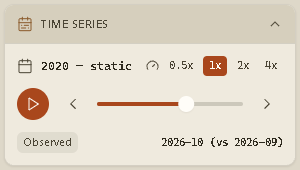
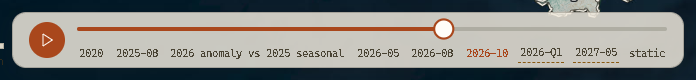

The source products run on very different calendars:

- **NISAR:** daily passes (28 Jun, 20/23/25/30 Sep, 14/17/19 Oct 2026) and monthly composites.
- **Landsat HLS:** quarterly, 2025-Q1 to 2026-Q3.
- **MODIS:** monthly, Dec 2024 to Oct 2026.
- **Outlook:** a forecast range, Nov 2026 to Oct 2027.
- **Pair and static products:** for example `2026-10 (vs 2026-09)`, `pre-quake 2026`, or `static` for terrain.

Instead of forcing them onto one calendar, the app uses **one global date** and lets each
layer keep its own periods.

## The global timeline

The timeline is `manifest.dates`: the sorted union of every layer's periods. There are
**81 periods** today. Sorting uses the primary date before any ` (vs …)` suffix, so a pair
product sits next to the date it describes.

On load, the current date defaults to `2026-10 (vs 2026-09)`, the period of the default
radar change layer.

## Moving through time

- **Time Series panel (left rail):** shows the current period, a scrubber, the play/pause
  button and the speed selector.
- **Animation bar (over the map):** a compact scrubber with ticks. Dragging pauses playback and
  resumes it when you let go, if it was playing.

## Period snapping

When the global date is not one of a layer's periods, the layer **snaps** to the nearest
period **at or before** the selection, or to the earliest period after it if none comes
before. The app tells you when this happens:

- The Time Series panel shows a `snapped: <period>` chip.
- The Current View card shows **Nearest available period for this layer**.
- A badge over the map reads **Showing nearest period for …**.

Layers whose only period is `static` (terrain) never snap.

## Playback

Press **Play** to step through `manifest.dates` in order. Playback loops back to the first
period after the last one.

| Speed        | Step interval |
| ------------ | ------------- |
| 0.5×         | 1.4 s         |
| 1× (default) | 0.7 s         |
| 2×           | 0.35 s        |
| 4×           | 0.175 s       |

Stepping uses `requestAnimationFrame`, so playback pauses while the window is hidden.

## Forecast periods

Periods from `2026-11` to `2027-10` belong to the **12-month El Niño scenario**. They are
marked differently on the animation bar, and the Time Series panel shows an **El Nino
Scenario** tag, so projections are never mistaken for observations.

:::caution
The outlook is a conditional climate scenario (sensitivity per +1 °C ONI), not a deterministic
weather forecast.
:::
