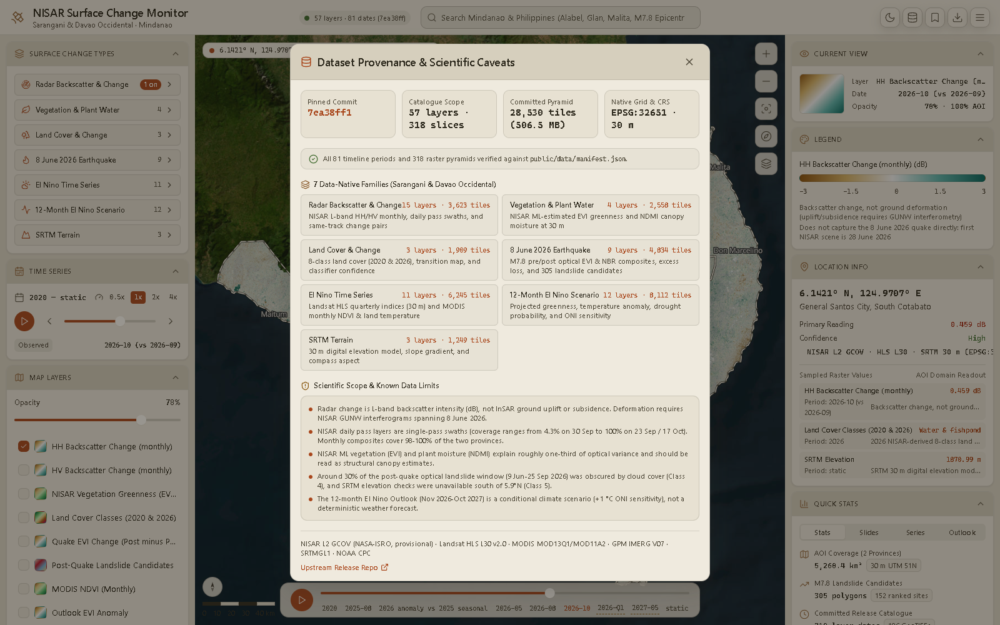

## Location search

The search box in the top bar filters a built-in gazetteer of **19 places** by name or
province:

- **Key sites:** the M7.8 quake epicentre (8 Jun 2026), and the Malalan (#1, 16.8 ha) and
  Mudan (#2, 7.6 ha) landslide clusters.
- **Sarangani:** Alabel (capital), Glan, Malapatan, Maasim, Kiamba, Maitum, Malungon, and the
  Balut and Tumanao islands.
- **Davao Occidental:** Malita (capital), Santa Maria, Don Marcelino, Jose Abad Santos.
- **Context:** General Santos City, Davao City, Manila, Cebu City.

Choosing a result flies the map to it and inspects that point, as if you had clicked there. On
narrow windows, search collapses to an icon button.

## Tools panel

The **Tools** panel in the left rail has four buttons:

| Tool | Behaviour |
| --- | --- |
| **Measure** | Toggle on, then click two points. A badge over the map shows the great-circle (haversine) distance in km and m. A third click starts a new measurement, and **×** clears it. |
| **Inspect** | Toggle the inspect mode. Clicking the map inspects in every mode; see [Inspecting locations](/guide/inspecting/). |
| **Bookmark** | Saves the last inspected point as a viewpoint at zoom 11. |
| **Export** | Downloads `nisar-export-<period>.json` with the active layer, current period and selected point. |

## Bookmarks

Open the **Bookmarks** menu in the top bar:

- **+ Save Current** saves the selected point. With no selection, it saves a default view over
  Sarangani.
- Click a saved viewpoint to fly to it.
- Use the trash icon to remove it.

In the desktop app, bookmarks persist through the Tauri store plugin. In the browser they stay in
memory for the session.

## Export snapshot

**Export → Download Inspection JSON** saves `nisar-inspection-<period>.json` with:

- `exportedAt`
- `activeLayer` and `currentDate`
- `selectedPoint`, including the sampled readings
- `source`: the release repository and pinned commit from the manifest

This makes any reading you share traceable to the exact data release.

## Data provenance

The database icon in the top bar, the data status pill, and **Settings → Release Provenance**
all open the **Dataset Provenance & Scientific Caveats** dialog. It shows:

- The pinned commit.
- Catalogue scope: layers and slices.
- Tile pyramid totals.
- The native grid and CRS.
- Tile request warnings, with a **Dismiss** button (none are reported yet).
- A per-family breakdown.
- The known data limits.
- Attribution, and a link to the upstream release.

Press **Esc** to close it. The full list of limits is on
[Provenance and limitations](/data/limitations/).

## Settings

The **Settings** menu (☰) holds the appearance toggle (warm light or Night Atlas dark) and a
shortcut to the provenance dialog.
