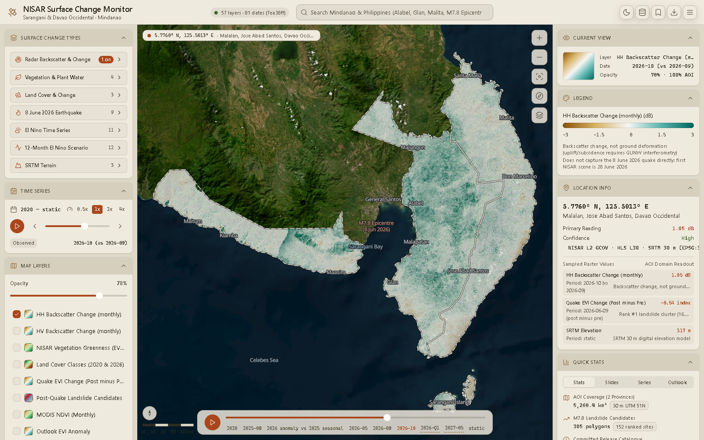

import { Card, CardGrid, LinkCard } from "@astrojs/starlight/components";

## What it does

<CardGrid stagger>
  <Card title="57 real layers, 7 families" icon="seti:image">
    Every overlay comes from a pinned NISAR release: radar backscatter and change, vegetation,
    land cover, the 8 June 2026 earthquake, El Niño time series, a 12-month outlook and terrain.
  </Card>
  <Card title="81-step timeline" icon="seti:clock">
    One global timeline covers daily NISAR passes, quarterly Landsat, monthly MODIS and the
    forecast scenario. Each layer snaps to its nearest available period.
  </Card>
  <Card title="Real pixel values" icon="magnifier">
    Click the map and the Tauri backend reads the source GeoTIFFs directly, returning scaled
    values, class names, units and caveats.
  </Card>
  <Card title="Honest provenance" icon="information">
    The pinned commit, tile totals and the release's own scientific limits are always one click
    away in the provenance dialog.
  </Card>
</CardGrid>

## Where to go next

<CardGrid>
  <LinkCard
    title="Installation"
    description="Install the toolchain and run the desktop app locally."
    href="/getting-started/installation/"
  />
  <LinkCard
    title="Layer catalogue"
    description="Every layer, its units, periods and zoom range."
    href="/data/catalogue/"
  />
  <LinkCard
    title="Tile pipeline"
    description="Turn the upstream GeoTIFF release into map tiles and a manifest."
    href="/pipeline/overview/"
  />
  <LinkCard
    title="Architecture"
    description="How the React frontend, stores and Tauri commands fit together."
    href="/architecture/overview/"
  />
</CardGrid>
