`docs/screenshots/*.png` are generated and committed. These docs reference the same files
directly, so regenerating them updates the documentation too.

## Requirements

- Python with `playwright` installed (`python -m pip install playwright`).
- Microsoft Edge. The script drives the installed Edge (`channel="msedge"`), so no
  `playwright install` browser download is needed.

The capture script adds no frontend dependencies.

## Capture

```bash
pnpm dev --host 127.0.0.1 --port 5173      # terminal 1
python scripts/capture_screenshots.py       # terminal 2; --url to point elsewhere
```

The run is a headless Edge session at **1600 × 1000** against the Vite dev server. It waits for
the **"57 layers"** status, collapses the radar and earthquake groups, then saves the files
below, in this order. Each image is the committed copy, so this page always shows the current
output.

## Output

### Light dashboard

`dashboard-light.png`: the default Sand Atlas theme.


### Dark dashboard

`dashboard-dark.png`: after switching to Night Atlas.

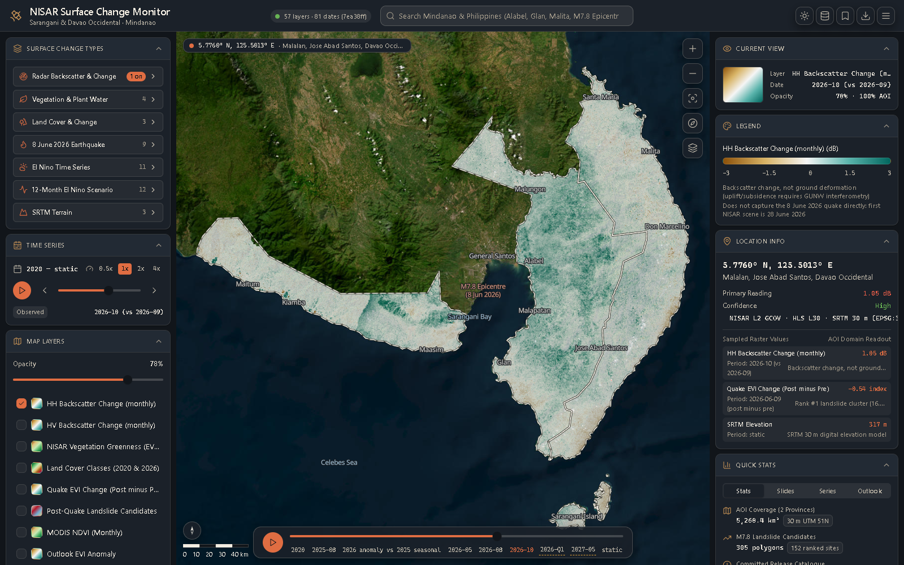

### Location inspection

`location-inspection.png`: back to light, after a map click at (430, 380).

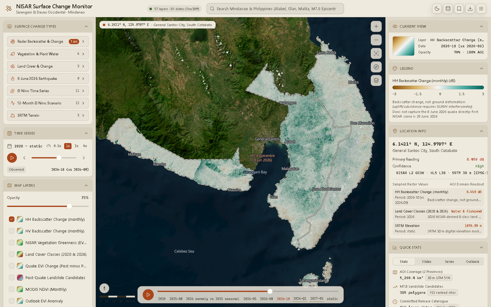

### Data provenance

`data-provenance.png`: with the data provenance dialog open.

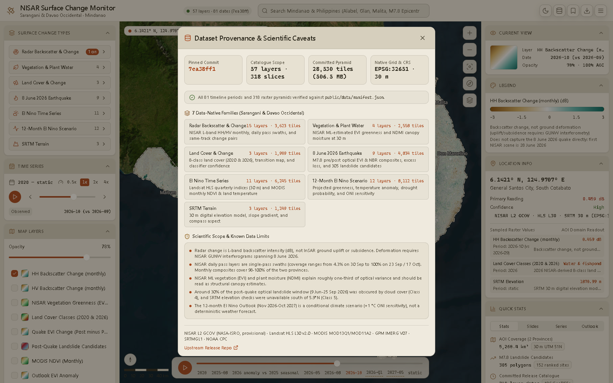

### Layers panels

`layers-change-types.png`, `layers-map-layers.png` and `layers-legend.png`: cropped panels for
the layers guide.

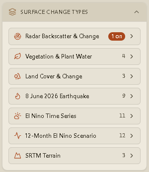

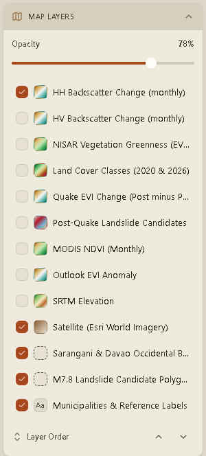

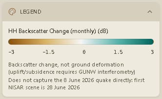

### Timeline

`timeline-panel.png` and `timeline-animation-bar.png`: the cropped Time Series panel and the map
animation bar.

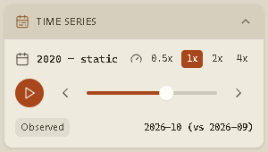

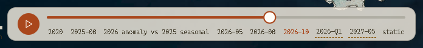

### Search

`search-results.png`: the search box with results for "Sarangani".

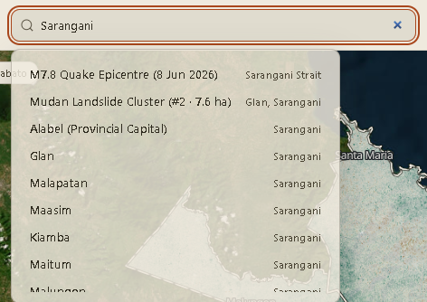

### Measure tool

`tools-panel.png` and `measure-distance.png`: Measure active, and the distance badge after two
clicks.

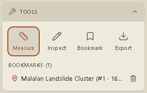

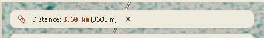

### Bookmarks

`bookmarks-menu.png`: the Bookmarks menu with the Malalan viewpoint saved.

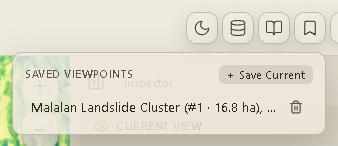

### Comparison view

`comparison-panel.png`: the Comparison View panel, enabled. `comparison-view.png`: the full
dashboard with the split curtain, after a fresh reload.

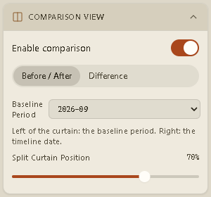

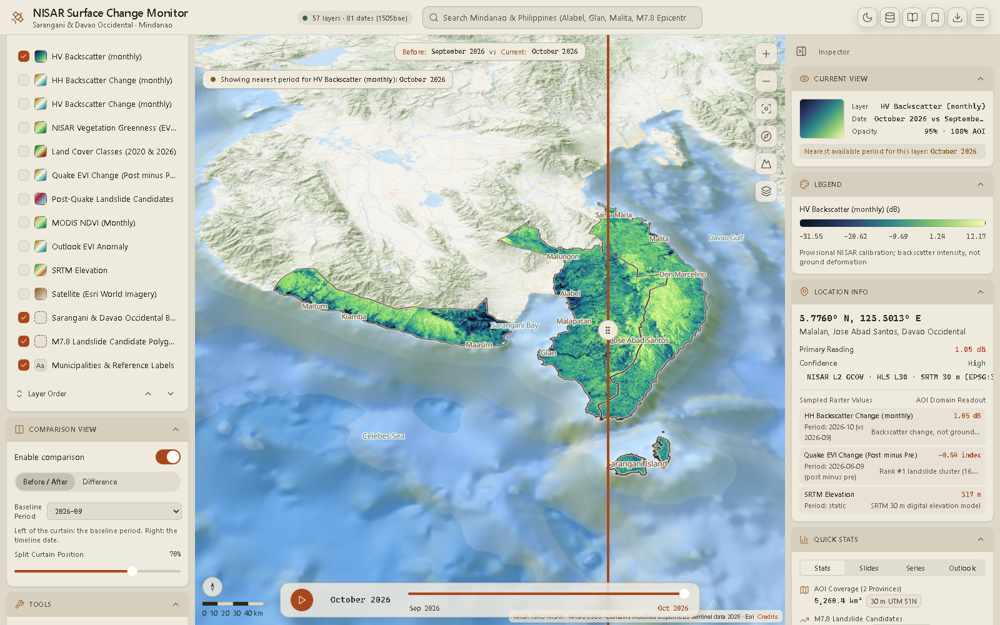

## Notes

:::caution
If the layer count or button labels change, update the selectors in
`scripts/capture_screenshots.py`.
:::

For overlays to appear in the screenshots, generate the tiles first; see
[Pipeline overview](/Dancing_with_the_SARs/pipeline/overview/).
